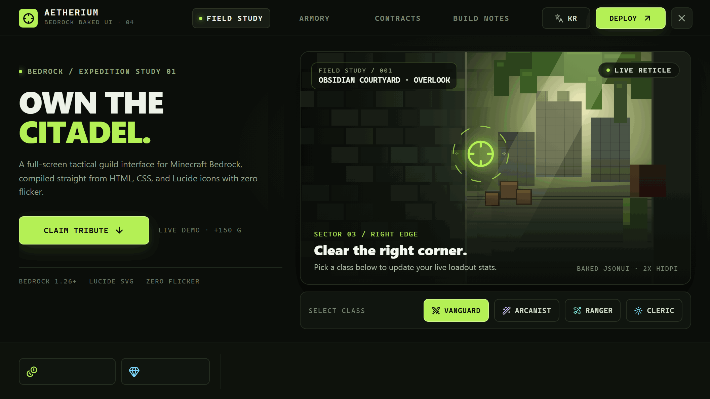
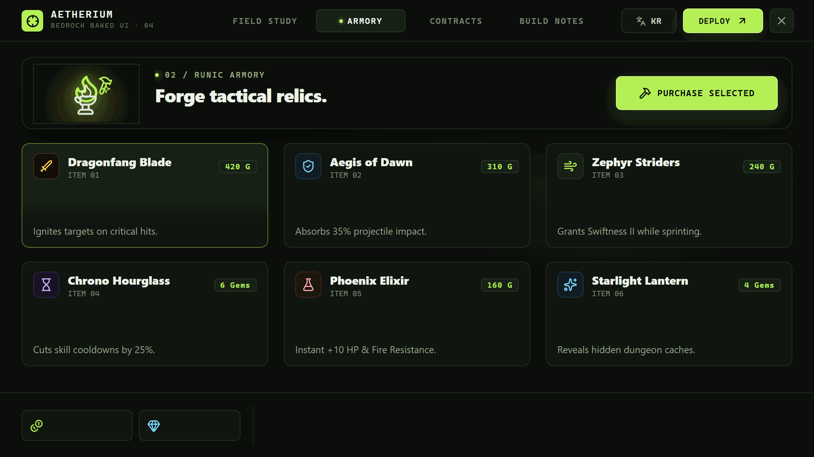
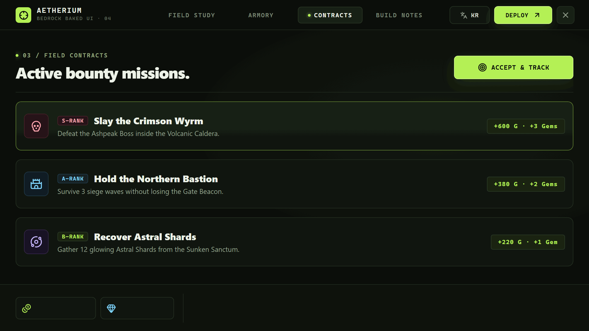
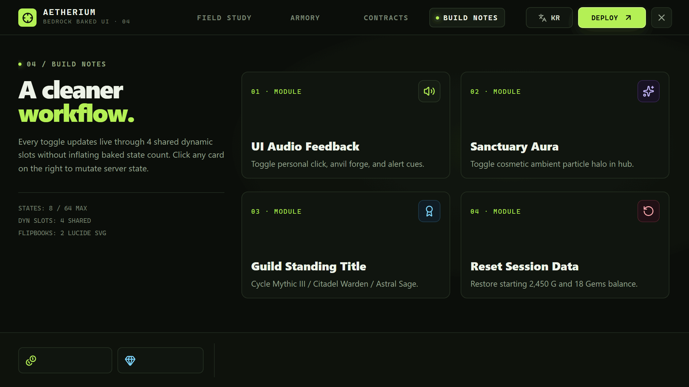
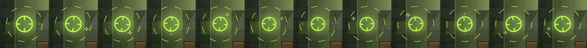

<div align="center">


# bedrock-baked-ui

**Compile HTML, CSS, SVG, and Canvas into native Minecraft Bedrock JsonUI**

Zero-flicker Entity Inventory UI + Pure-Node Compiler & TypeScript Runtime SDK

[](https://www.npmjs.com/package/bedrock-baked-ui)
[](https://discord.gg/rNKWYb2V7v)
[-52a535?style=flat)](https://www.minecraft.net)
[](https://nodejs.org)
[](#why-baked-ui)
[](https://www.typescriptlang.org)
[](#license)

</div>

---

## Showcase

Built with standard HTML, CSS, and **[Lucide Icons](https://lucide.dev)** (`examples/guild-codex`), then compiled directly into native Bedrock JsonUI (`ui/chest_screen.json`, `ui/pocket_containers.json`, `ui/server_form.json`) with **2x HiDPI PNGs**, **Lucide SVG `flip_book` animations**, and **zero-flicker in-place state switching**.

<table>
  <tr>
    <td></td>
    <td></td>
  </tr>
  <tr>
    <td></td>
    <td></td>
  </tr>
</table>

<div align="center">
  <sub>Animated Lucide SVG <code>flip_book</code> spritesheets baked automatically in pure Node.js:</sub><br/><br/>
  <br/>
  
</div>

```bash
node dist/cli.js dev --config examples/guild-codex
node dist/cli.js bake --config examples/guild-codex
node dist/cli.js validate --config examples/guild-codex
node examples/guild-codex/build_mcpack.mjs
```

---

## Why Baked UI?

Writing rich Minecraft Bedrock UIs directly in **JsonUI** (`ui/chest_screen.json`, `ui/pocket_containers.json`, `ui/server_form.json`, `ui/hud_screen.json`) is verbose and slow to iterate on, yet standard JsonUI works reliably across normal `.mcpack` resource packs, Realms, and dedicated servers.

`bedrock-baked-ui` lets you author interfaces using web standards and compiles them into Bedrock-native assets with **zero runtime npm dependencies**, **no Puppeteer/Playwright**, and **no Python/Pillow**:

- **Zero-flicker Fullscreen Menus (`baked-ui bake`)**: Uses an invisible, zero-collision 27-slot container entity (`chest_screen.json` + `pocket_containers.json`) so clicking buttons updates screens and dynamic text **in-place** without closing or reopening the UI.
- **`ActionFormData` Fallback (`server_form.json`)**: Automatically emitted alongside Entity Inventory UI for chat commands or fallback environments.
- **HiDPI Static Screens + Pure-JS PNG Quantization**: Renders crisp `2x`/`3x` screenshots using your system Chrome/Edge via raw CDP and shrinks opaque PNGs with a built-in median-cut 256-color quantizer.
- **Real CSS `:hover` & `:active` Button States (`data-hit-fx="1"`)**: Forces pseudo-states via CDP to bake genuine HTML/CSS hover and pressed button textures directly into JsonUI (`$hover_tex` / `$press_tex`) alongside per-button custom sounds (`data-sound`).
- **Native 60fps JsonUI Motions (`[data-motion]`)**: Extracts clean transparent RGBA sprites (with ghost-free static backgrounds) and compiles chained Bedrock native `offset`, `size`, `alpha`, and `wait` animations for both looping motions (`float`, `pulse`, `glow`, `slide-x`) and staggered one-shot entrances (`enter-up`, `enter-fade`, `enter-pop`) in Menus & HUDs, with live CSS preview in `baked-ui dev`.
- **Real-Time Progress Bars (`[data-bar]`)**: Renders live server `0..100` percentages in 20 smooth 5% steps over your custom HTML/CSS gradient bar textures (`left|right|up|down`).
- **One-Click `.mcaddon` Packaging (`baked-ui pack`)**: Pure-Node POSIX ZIP packager + `dev --watch --auto-bake` live reload + full `init` manifests.
- **`flip_book` SVG/Canvas/CSS Animations (`[data-anim]`)**: Captures seamless loop frames and stitches horizontal spritesheets + JsonUI `flip_book` bindings automatically in pure Node.js.
- **Live Server-Driven Text (`[data-dyn]`)**: Samples parent solid background colors to mask placeholder text and overlays live `ItemStack.nameTag` values directly in JsonUI.
- **Behavior Pack Runtime SDK (`bedrock-baked-ui/runtime`)**: Drop-in `BakedMenuManager` with early-execution safety, PvP auto-dodge, melee hit pass-through, tick-late marker sweep safety, and orphan entity cleanup.
- **Experimental Transparent HUD (`baked-ui bake-hud`)**: Compiles transparent `[data-hud-widget]` overlays and byte-sliced `[data-hud-dyn]` live telemetry fields (supports both `subtitle` and `title` channels).

---

## Requirements

- **Node.js >= 22** (uses built-in `WebSocket`, `fetch`, and `node:zlib`)
- **Microsoft Edge, Google Chrome, or Chromium** installed locally (auto-detected on Windows/macOS/Linux, or set `BAKED_UI_BROWSER=/path/to/chrome`)

---

## Quick Start

### 1. Scaffold a starter project

```bash
npx bedrock-baked-ui init ./my-addon --namespace my_ui --theme gold
cd my-addon
```

This creates:
- `baked-ui.config.json`: compiler configuration
- `ui-src/index.html`: interactive 3-tab starter menu (`[data-hit]`, `[data-dyn]`, `[data-anim]`)
- `ui-src/hud.html`: experimental transparent HUD template
- `packs/bp/src/menu_example.ts`: Behavior Pack wiring example

### 2. Preview & inspect budgets in your browser

```bash
npx bedrock-baked-ui dev
```

Open `http://127.0.0.1:4173/` and press **`Shift+I`** (or click **Boxes: OFF**) to toggle the live Inspector overlay showing hitbox bounds, `[data-dyn]` opaque-background warnings, animation sheet limits, and your `buttons + dyn <= 25` slot budget.

### 3. Bake into Bedrock Resource Pack & Behavior Pack

```bash
npx bedrock-baked-ui bake
npx bedrock-baked-ui validate
```

Generated outputs:
- **RP**: `textures/ui/<subdir>/*.png`, `ui/<ns>.json`, `ui/chest_screen.json`, `ui/pocket_containers.json`, `ui/server_form.json`, `ui/_ui_defs.json`, plus invisible client entity/geometry/render controller.
- **BP**: `entities/<ns>_<name>.json` and `src/generated/baked_site.json` manifest.

### 4. Wire the Behavior Pack Runtime SDK

Put this code in **`packs/bp/src/main.ts`**, the Behavior Pack script entry that `baked-ui pack` bundles. `init` scaffolds a starter copy at `packs/bp/src/menu_example.ts`, so you can rename it to `main.ts`. The `./generated/baked_site.json` import is the manifest that `bake` writes next to it (`packs/bp/src/generated/baked_site.json`).

```ts
// packs/bp/src/main.ts
import { system, world } from '@minecraft/server';
import { BakedMenuManager, fitText } from 'bedrock-baked-ui/runtime';
import manifest from './generated/baked_site.json';

const menu = new BakedMenuManager(manifest, {
  triggerItemId: 'minecraft:compass',
  resolveDynamicValues(player, state) {
    return {
      coins: '§6§l1,250 G',
      gems: '§b§l12 Gems',
      line1: fitText(`§aWelcome, ${player.name}!`, 58),
      line2: fitText(`§7Page: ${state.bakedKey}`, 58),
    };
  },
  onButtonClick(player, button) {
    if (button.hitId === 'act_claim') {
      player.playSound('random.levelup', { volume: 0.6, pitch: 1.2 });
    }
  },
});

menu.install();

world.beforeEvents.chatSend.subscribe((ev) => {
  if (ev.message.trim() === '!menu') {
    ev.cancel = true;
    system.run(() => menu.open(ev.sender));
  }
});
```

### 5. Pack into a `.mcaddon`

Bedrock can't load TypeScript, npm imports, or JSON imports directly, so the script has to be bundled. Install esbuild and `bedrock-baked-ui` locally once (the runtime import gets bundled into `main.js`, and an `npx`-only install isn't visible to esbuild), then run `pack`:

```bash
npm i -D esbuild bedrock-baked-ui
npx bedrock-baked-ui pack
```

`pack` runs these steps in order:
1. Bakes the UI again (skip with `--no-bake`).
2. Validates the result.
3. Bundles `packs/bp/src/main.ts` into `packs/bp/scripts/main.js` with esbuild. This file is the `entry` in the BP `manifest.json`. `@minecraft/server` and `@minecraft/server-ui` stay external.
4. Writes `dist/<ns>.mcaddon` containing `<ns>_bp/` and `<ns>_rp/`.

To install the add-on, double-click the `.mcaddon` file.

```text
packs/bp/
  manifest.json              # script entry: scripts/main.js
  src/
    main.ts                  # your runtime code (step 4)
    generated/baked_site.json
  scripts/main.js            # produced by `pack`
```

> If esbuild isn't found in `node_modules`, `pack` skips bundling without an error. Look for `BP bundled` in its output. To use your own bundler instead, pass `--no-bundle` and write the output to `packs/bp/scripts/main.js`. Use `--out <path>` to change where the `.mcaddon` is written.

---

## HTML Authoring Contract

Your HTML page exposes `window.__BAKE__` so the headless crawler can discover every reachable UI state:

```js
window.__BAKE__ = {
  getStateKey() { return state.tab; },
  setStateKey(key) { state.tab = key; render(); },
  clickHit(hitId) { /* trigger click */ return state.tab; },
  // Optional:
  getMeta() { return { url: 'baked://' + state.tab, title: document.title }; },
  setAnimFrame(phase) { /* phase in [0, 1) */ redrawAnim(phase); },
  whenReady() { return Promise.all(/* wait for images/fonts */); },
};
```

### Supported `data-*` Attributes

| Attribute | Target | Description |
| --- | --- | --- |
| `data-hit="<id>"` | Menu | Interactive button hitbox (`>= 6x6px`). |
| `data-hit-fx="1"` | Menu | Captures real CSS `:hover` & `:active` styles for this button (`data-hit-fx-key` to share across states). |
| `data-sound="<id>"` | Menu | Custom Bedrock sound played on button click (`data-sound-pitch`, `data-sound-volume`). |
| `data-label="<text>"` | Menu | Short label attached to the slot marker / ActionForm button. |
| `data-special="close"` | Menu | Maps click to `button.menu_exit` and closes the menu. |
| `data-dyn="<id>"` | Menu | Live server-updated text slot. Ancestor must have opaque `background-color` (alpha > 0.85). |
| `data-dyn-scale="0.95"` | Menu / HUD | JsonUI `font_scale_factor`. |
| `data-dyn-align="left"` | Menu / HUD | JsonUI `text_alignment` (`left` \| `center` \| `right`). |
| `data-bar="<id>"` | Menu | Real-time `0..100` progress bar clipped natively via `#clip_ratio` (`data-bar-dir="left\|right\|up\|down"`). |
| `data-anim="<id>"` | Menu / HUD | Animated region baked into a `flip_book` spritesheet (`data-frames`, `data-fps`, optional `data-anim-key`). |
| `data-motion="<id>"` | Menu / HUD | Smooth 60fps native JsonUI sprite (`float\|pulse\|glow\|slide-x\|slide-y\|enter-up\|enter-down\|enter-left\|enter-right\|enter-fade\|enter-pop`, combinable with `+`). |
| `data-motion-*` | Menu / HUD | Motion tuning: `data-motion-amp` (px), `data-motion-scale` (`1.08`), `data-motion-min`/`max` (`0.35`..`1.0`), `data-motion-duration` (sec), `data-motion-delay` (sec), `data-motion-easing` (`in_out_sine`), `data-motion-pad` (px for shadows), `data-motion-key`. |
| `data-hud-widget="<id>"` | HUD | Transparent HUD card captured cleanly without placeholder text. |
| `data-hud-dyn="<id>"` | HUD | Fixed-byte ASCII field (`data-dyn-len="20"`) or single UTF-8/color tail (`data-dyn-tail="1"`). |

---

## Bedrock Constraints at a Glance

| Constraint | Hard Limit | Notes |
| --- | --- | --- |
| Slots per menu page | **25 total** (`buttons + global unique [data-dyn] <= 25`) | Slot 0 is blank, Slot 1 holds state tag (`§s§XX`). Reuse `[data-dyn]` coordinates across pages so they share 1 slot. |
| Reachable states | Default **64** (hard cap **100**: `§s§00..§s§99`) | Keep `getStateKey()` additive across tabs instead of multiplicative. |
| Unique hitbox rectangles | **100** (`§h§00..§h§99`) | Align button grids across tabs to reuse hitbox tags. |
| Dynamic bg mask variants | **10 per dyn slot** (`§9§0..§9§9`) | Parent of `[data-dyn]` must have solid opaque `background-color`. |
| Flipbook sheet width | **2800px** (`frameW * frames`) | Automatically downscaled if wider; frame 0 and frame 1 must differ. |
| HUD fixed fields | **Single-byte ASCII** (`0x20..0x7E`) | Place non-ASCII (CJK, emoji) & `§` colors in the single `data-dyn-tail="1"` slot. |

See [docs/guide.md](docs/guide.md) for the complete architecture reference, troubleshooting tips, and experimental HUD notes.

---

## CLI Reference

```bash
baked-ui init [dir] [--namespace <ns>] [--entity <ns:name>] [--theme gold|classic|neon|minimal] [--no-hud] [--force]
baked-ui dev [--config <path>] [--port 4173] [--hud] [--watch] [--auto-bake]
baked-ui bake [--config <path>] [--scale 1..3] [--no-quantize]
baked-ui bake-hud [--config <path>] [--scale 1..4] [--channel subtitle|title]
baked-ui validate [--config <path>]
baked-ui pack [--config <path>] [--out <path>] [--no-bake] [--no-bundle]
```

## Community

Have questions, feedback, or showcase UIs built with `bedrock-baked-ui`? Join the Discord server:

- **Discord**: https://discord.gg/rNKWYb2V7v

## License

MIT
